# Lab5web
# LAPORAN PRAKTIKUM 5
## JavaScript Dasar dan Manipulasi HTML

### Identitas Mahasiswa
- **Nama:** Miftah Ma’ruf
- **Kelas:** I253A
- **Mata Kuliah:** Pemrograman Web

## menambahkan foto
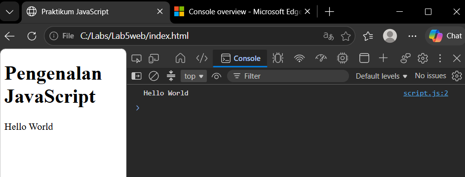
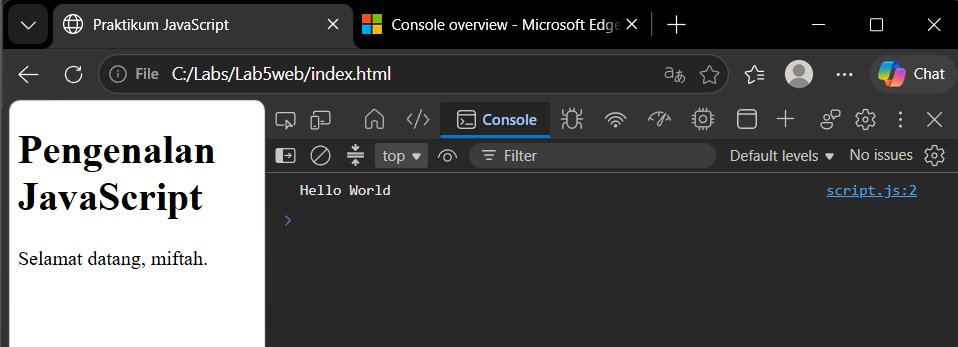
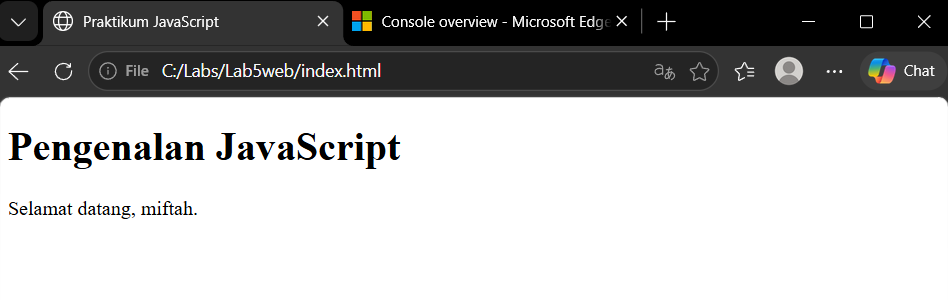
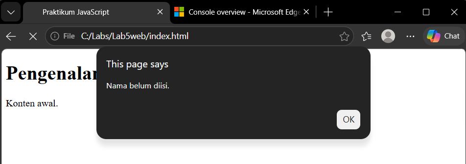
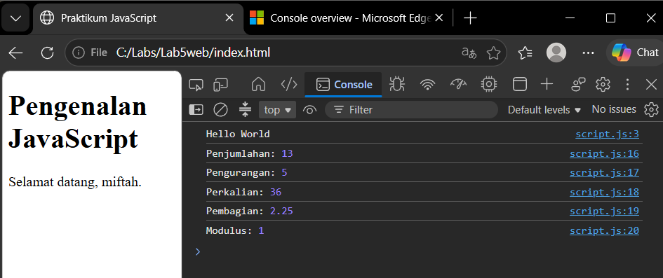
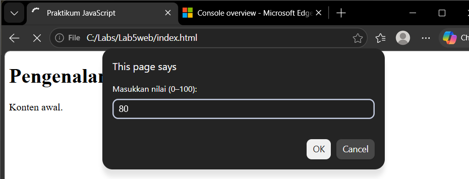
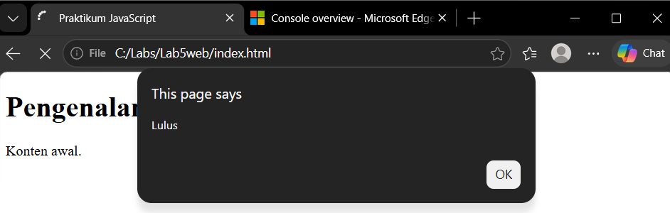
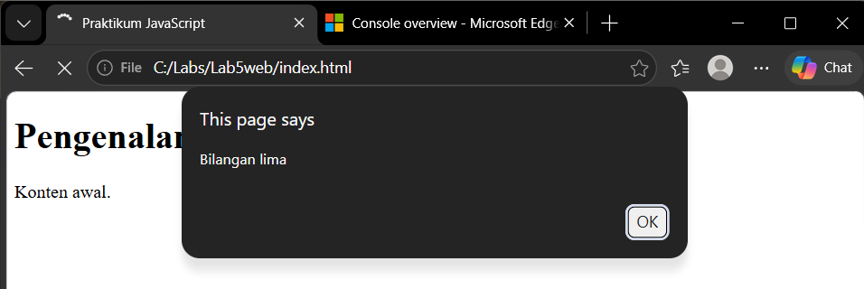
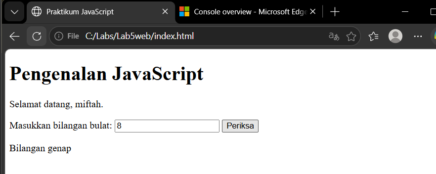
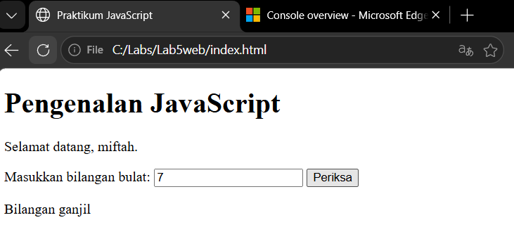
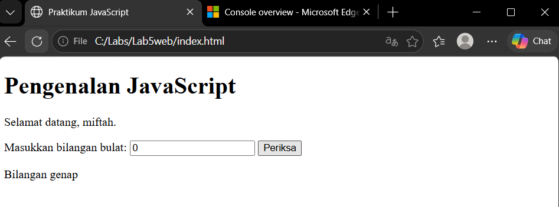
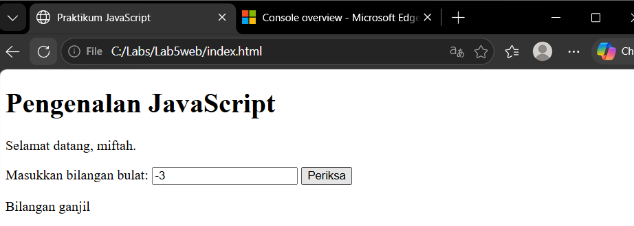
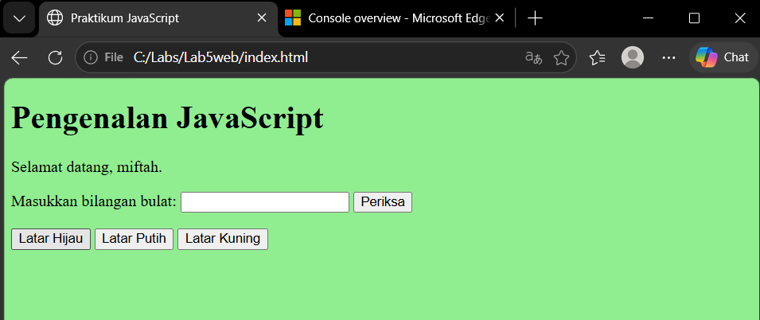
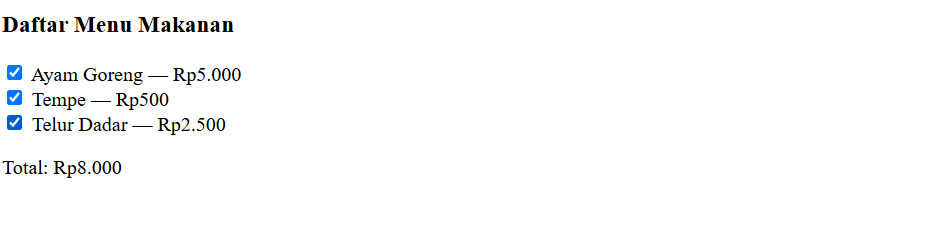

---

## A. Langkah Kerja Praktikum

### Step 1 – Menampilkan Output JavaScript

**Proses:** Menggunakan `textContent` untuk mengubah teks HTML dan `console.log()` untuk menampilkan pesan pada Console.

**Hasil:** Teks `Hello World` ditampilkan pada halaman web dan Console browser.

### Step 2 – Menggunakan Alert dan Prompt

**Proses:** Menggunakan `prompt()` untuk meminta nama pengguna dan `alert()` untuk menampilkan pesan. Program memeriksa apakah nama sudah diisi.

**Hasil:** Program menampilkan pesan selamat datang jika nama diisi dan pemberitahuan jika nama belum diisi.

### Step 3 – Function dan Operasi Aritmetika

**Proses:** Membuat function untuk melakukan penjumlahan, pengurangan, perkalian, pembagian, dan modulus dari dua bilangan.

**Hasil:** Program menghitung dan menampilkan hasil operasi aritmetika pada Console.

### Step 4 – Percabangan If–Else

**Proses:** Membuat program untuk menerima nilai mahasiswa melalui `prompt()`. Nilai minimal 60 dinyatakan lulus, sedangkan nilai di bawah 60 dinyatakan belum lulus.

**Hasil:** Program menentukan status kelulusan berdasarkan nilai yang dimasukkan.

### Step 5 – Percabangan Switch

**Proses:** Membuat program yang meminta pengguna memasukkan angka 1–5. Setiap angka memiliki hasil berupa nama bilangan yang sesuai.

**Hasil:** Program menampilkan nama bilangan berdasarkan pilihan pengguna. Input di luar pilihan menampilkan pesan bahwa pilihan tidak tersedia.

### Step 6 – Form Bilangan Genap dan Ganjil

**Proses:** Membuat kolom input bilangan bulat dan tombol Periksa. Program menggunakan operator modulus (`%`) untuk menentukan apakah bilangan genap atau ganjil.

**Hasil:** Program menampilkan keterangan bilangan genap atau ganjil serta pesan jika input tidak valid.

### Step 7 – Mengubah Warna Latar Halaman

**Proses:** Membuat tiga tombol untuk mengubah warna latar halaman menjadi hijau, putih, dan kuning menggunakan function `ubahWarnaLatar()`.

**Hasil:** Warna latar halaman berubah sesuai tombol yang dipilih pengguna.

### Step 8 – DOM dan Checkbox Menu Makanan

**Proses:** Membuat daftar menu makanan menggunakan checkbox. Setiap menu memiliki harga dan program menghitung total berdasarkan menu yang dipilih.

**Hasil:** Total harga berubah secara otomatis ketika pengguna mencentang atau menghapus centang pada pilihan menu.

---

## B. Mini Project – Kalkulator Nilai Mahasiswa

**Proses:** Membuat program untuk menghitung nilai akhir mahasiswa berdasarkan tiga komponen nilai dengan ketentuan:

- Nilai tugas: 30%
- Nilai UTS: 30%
- Nilai UAS: 40%

Program menentukan nilai akhir, predikat, dan status kelulusan mahasiswa.

**Hasil:** Program dapat menghitung nilai akhir berdasarkan bobot yang ditentukan serta menentukan predikat dan status kelulusan.

---

## C. Jawaban Pertanyaan Praktikum

**1. Jelaskan perbedaan `console.log()`, `alert()`, `prompt()`, dan `textContent`.**

- `console.log()` menampilkan informasi pada Console.
- `alert()` menampilkan pesan melalui kotak dialog.
- `prompt()` meminta masukan dari pengguna.
- `textContent` mengubah teks pada elemen HTML.

**2. Apa perbedaan `let` dan `const`?**

`let` digunakan untuk variabel yang nilainya dapat diubah, sedangkan `const` digunakan untuk variabel yang tidak dapat ditetapkan ulang.

**3. Apa perbedaan operator `==` dan `===`?**

Operator `==` membandingkan nilai dengan kemungkinan konversi tipe data, sedangkan `===` membandingkan nilai sekaligus tipe datanya.

**4. Jelaskan fungsi `if–else` dan `switch`.**

`if–else` digunakan untuk menjalankan perintah berdasarkan kondisi tertentu. `switch` digunakan untuk memilih perintah berdasarkan nilai yang sesuai dengan salah satu pilihan.

**5. Apa fungsi parameter dan `return` dalam function?**

Parameter digunakan untuk menerima data masukan, sedangkan `return` digunakan untuk mengembalikan hasil dari function.

**6. Bagaimana JavaScript memilih elemen HTML menggunakan `getElementById()`?**

`document.getElementById()` digunakan untuk mencari dan memilih elemen HTML berdasarkan nilai atribut `id`.

**7. Bagaimana cara memvalidasi nama dan nilai pada form?**

JavaScript memeriksa apakah nama sudah diisi dan memastikan nilai berada pada rentang 0–100. Jika input tidak memenuhi ketentuan, program menampilkan pesan kesalahan.

---
## D. Dokumentasi

Screenshot hasil setiap latihan disertakan sebagai bukti pelaksanaan praktikum.

Seluruh file program dan dokumentasi disimpan dalam repository GitHub `Lab5Web` sesuai ketentuan pengumpulan.

---

## E. Kesimpulan

Praktikum ini memberikan pemahaman mengenai penggunaan JavaScript untuk membuat halaman web lebih interaktif. Materi yang dipraktikkan meliputi output, operasi aritmetika, function, percabangan, manipulasi DOM, form, dan validasi input.